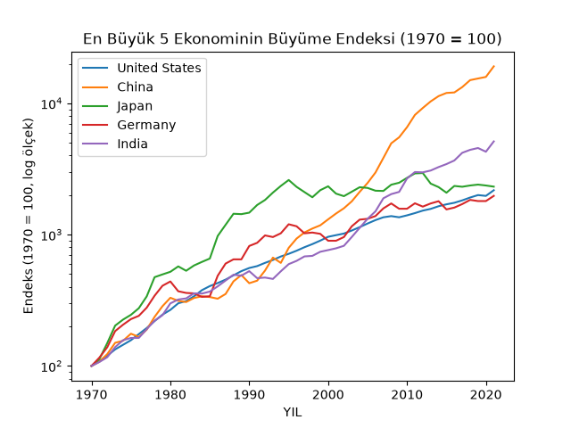
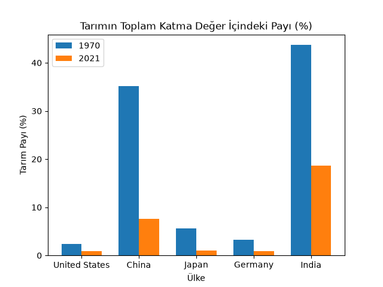
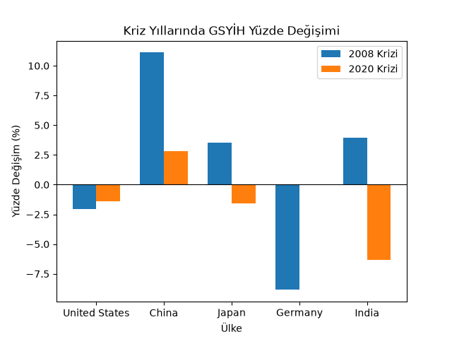

# Global Ekonomi Göstergeleri: Keşifsel Veri Analizi (EDA)

Bu proje, [Global Economy Indicators](https://www.kaggle.com/datasets/prasad22/global-economy-indicators) veri setini kullanarak 1970-2021 yılları arasında dünyanın en büyük ekonomilerinin büyüme, yapısal dönüşüm ve kriz dayanıklılığını inceler. Analiz Python (pandas, matplotlib, NumPy) ile yapılmıştır.

## Kurulum

```bash
pip install pandas matplotlib numpy
python analiz.py
```

`data/` klasöründe `Global Economy Indicators.csv` dosyasının bulunması gerekir.

## Araştırma Soruları ve Bulgular

### 1. Günümüzdeki dünya ekonomi devlerinin 1970'ten 2021'e kadar olan GSYİH değerleri ve bu değerlerin grafiklerle görselleştirilmiş halleri

2021 itibarıyla en büyük 5 ekonomi (ABD, Çin, Japonya, Almanya, Hindistan) için 1970 yılı 100 kabul edilerek bir büyüme endeksi hesaplanmıştır.



İncelenen 5 ülke arasında **Çin**, endeksini 1970-2021 arasında yaklaşık **19.114**'e (yani başlangıcının ~191 katına) çıkararak açık ara en hızlı büyüyen ekonomi olmuştur. Onu **Hindistan** (~5.126, ~51 kat) izlemektedir. **Japonya** ilginç bir örüntü sergilemiş; 1970-1995 arasında hızla büyürken, sonraki 25 yılda neredeyse durgunlaşmış ve toplamda ABD'ye (~2.178) yakın bir seviyede (~2.319) kalmıştır. **Almanya** (~1.972) incelenen ülkeler arasında en yavaş büyüyen ekonomi olmuştur.

### 2. Bu ülkelerin 1970 ve 2021 arasındaki katma değerlerine tarım sektörünün etkisi

Tarım, avcılık, ormancılık ve balıkçılık sektörünün toplam katma değer içindeki payı, aynı 5 ülke için 1970 ve 2021 yıllarında karşılaştırılmıştır.



Beş ülkenin **tamamında** tarımın payı azalmıştır, bu da ekonomik gelişmeyle birlikte tarımdan sanayi/hizmet sektörlerine geçiş kuramını doğrular niteliktedir. Düşüş en çok **Çin**'de (%35,1 → %7,6) ve **Hindistan**'da (%43,7 → %18,6) belirgindir; bu iki ülke aynı zamanda Soru 1'de en hızlı büyüyen ekonomilerdir. **ABD, Japonya ve Almanya** ise 1970'te zaten düşük bir tarım payına sahipti (%2-6 aralığı) ve 2021'de bu oran %1'in altına inmiştir.

### 3. 1970 ile 2021 yılları arasında oluşan önemli iki krizde ülkelerin GSYİH değişimleri

2008-2009 küresel finans krizi ve 2020 COVID-19 krizi sırasında, kriz yılındaki GSYİH'nin bir önceki yıla göre yüzde değişimi hesaplanmıştır.



İki kriz **farklı ülkeleri** farklı şiddette etkilemiştir. 2008 krizinde en sert düşüşü **Almanya** (-%8,85) yaşarken, **Çin** bu dönemde pozitif büyümesini sürdürmüştür (+%11,11). 2020 krizinde ise tablo değişmiş, en sert düşüşü **Hindistan** (-%6,32) yaşamış, **Almanya**'nın GSYİH'si ise neredeyse hiç değişmemiştir (0,0). Bu sonuç, "küresel bir krizin tüm ülkeleri benzer şekilde vurduğu" varsayımını çürütmekte, her krizin kendine özgü bir coğrafi etkisi olduğunu göstermektedir.

## Sınırlamalar ve Notlar

- GSYİH değerleri muhtemelen cari (nominal) fiyatlarla verilmiştir; enflasyon ve kur etkileri ayrıştırılmamıştır. Özellikle Japonya ve Almanya'nın dolar cinsinden büyüme rakamları, yen ve markın dolar karşısındaki değer değişimlerinden etkilenmiş olabilir.
- İncelenen 5 ülke, **2021'deki** büyüklüklerine göre seçilmiştir; bu, "bugün büyük olan, geçmişte de büyümüş" yönünde bir seçim yanlılığı taşır.
- Almanya'nın 2019-2020 GSYİH değişiminin veri setinde tam olarak 0,0 çıkması; bu durumun gerçek bir durgunluktan mı yoksa veri setinin hassasiyetinden mi kaynaklandığı ayrıca doğrulanmamıştır.
- Kriz analizi yalnızca kriz yılındaki düşüşe odaklanmaktadır; toparlanma süresi (kriz öncesi seviyeye dönüş hızı) bu projenin kapsamı dışında bırakılmıştır.

## Kullanılan Veri Seti

[Global Economy Indicators (1970-2021)](https://www.kaggle.com/datasets/prasad22/global-economy-indicators) — Kaggle
